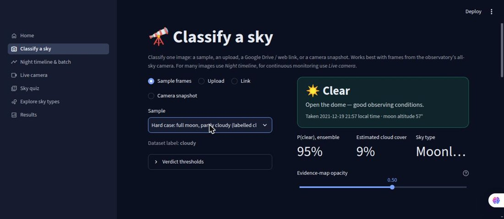
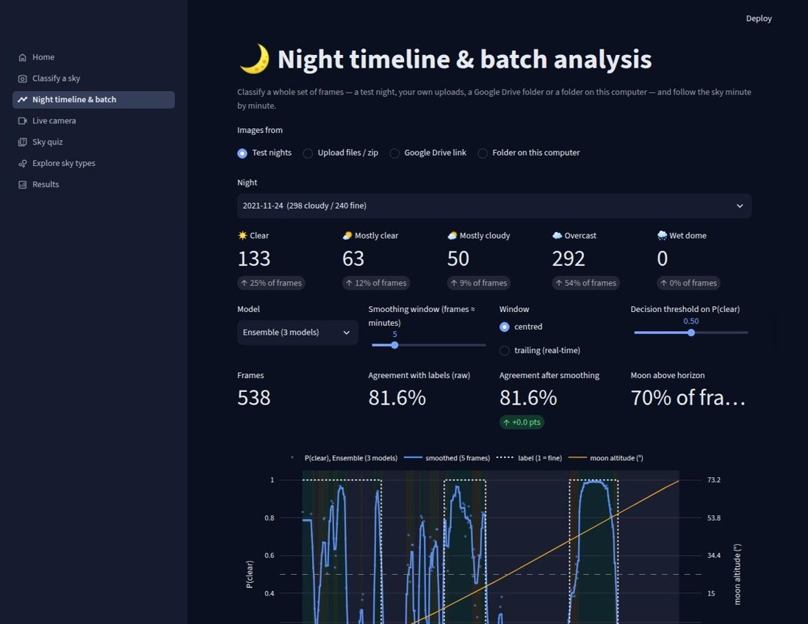
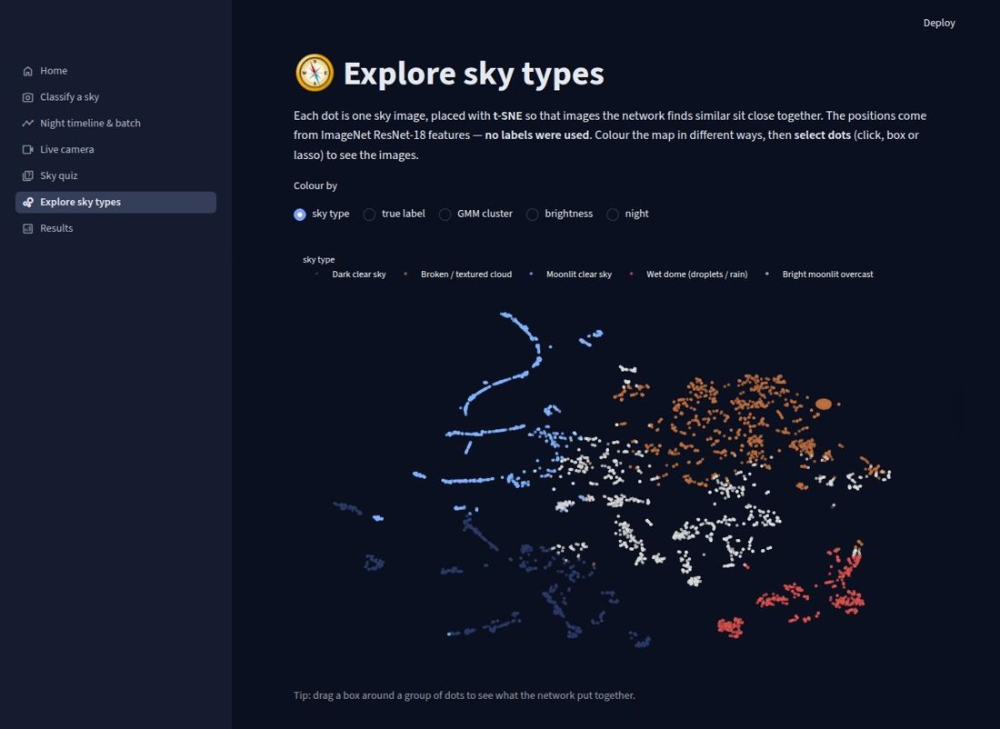

# 🌌 Sky Monitor AI for Remote Observatory Operations

**Automatic sky-condition classification for an observatory all-sky camera, with CNNs, unsupervised
sky types and model interpretation, as an interactive Streamlit app.**

[](https://YOUR-APP-URL.streamlit.app)

A small auxiliary camera at the Higashi-Hiroshima Observatory (Hiroshima University) photographs the whole
sky about once a minute. This project trains convolutional neural networks on **8,806 frames from 32 nights**
to decide whether the sky is clear enough to observe, a step towards automating operations such as opening
and closing the dome.

| Classify a sky | Night timeline | Explore sky types |
|---|---|---|
|  |  |  |

📖 The full story of the project, from the data to this app, is told in the book
*Clear or Cloudy? Deep Learning for Sky Monitoring at the Higashi-Hiroshima Observatory* (Muhammad Waqas),
`docs/Clear_or_Cloudy_Muhammad_Waqas.pdf`.

## What the app does

| Page | What you can do |
|---|---|
| 🔭 **Classify a sky** | One image from a sample, an upload, a **Google Drive / web link** or a **camera snapshot** → **Clear / Mostly clear / Mostly cloudy / Overcast / Wet dome**, P(clear), estimated cloud cover, sky type, and an interactive **evidence map** of where the sky looks clear or cloudy |
| 🌙 **Night timeline & batch** | Many images at once: the test nights, uploaded files or a zip, a **shared Google Drive folder** (subfolders included, no 50-file limit) or a **local folder** → timeline with moon altitude, smoothing, frame viewer and CSV export |
| 📡 **Live camera** | Connect to the observatory camera: **watch the folder** the camera writes to, poll a **latest-image URL**, or read a **USB / RTSP / MJPEG stream**. Every new frame is classified automatically, with a live timeline, change alerts and a downloadable log |
| 🛰️ **Weather & satellite** | Choose any observatory or city (from a list, by name search, or by coordinates — and save your own places). See the hour-by-hour **forecast** (Open-Meteo, incl. low/mid/high cloud cover) and the **satellite picture** of the area (NASA GIBS: Himawari-9 / GOES every 10 min, VIIRS daily elsewhere) for now or any past time, and compare both with a camera frame. Needs internet |
| 🎯 **Sky quiz** | Judge the sky yourself (clear, partly cloudy, cloudy) and compare with the labels and the model |
| 🧭 **Explore sky types** | Interactive t-SNE map of 4,000 frames clustered **without labels**: dark clear, moonlit clear, broken cloud, moonlit overcast, and **water droplets on the dome** |
| 📊 **Results** | Model comparison, per-night accuracy, the moon effect, smoothing, confusion matrices, training curves, all live with an adjustable decision threshold |

## How it works

1. **Sky mask.** Everything outside the fisheye circle (date stamp, captions) is blacked out, so the
   network cannot learn the *date* instead of the *sky*.
2. **Three CNNs.** A small CNN trained from scratch (0.39 M parameters) and two ImageNet-pretrained
   ResNet-18 variants (frozen backbone; regularised layer-4 fine-tuning). The final prediction is their
   average, selected on validation nights.
3. **Evidence map.** Each network ends in global average pooling + a linear layer, so the output logit
   difference is *exactly* the spatial mean of a local logit map `Δw·A(x,y) + Δb`. Its sigmoid shows what
   each part of the sky says on its own; the share of the sky below 0.5 is the cloud-cover estimate.
4. **Sky type.** Nearest of five K-means clusters in ImageNet ResNet-18 feature space (found without labels).
5. **Verdict.** P(clear) + cloud cover + sky type → five conditions. The models were trained on two classes
   only; the intermediate levels are derived and indicative.

## Results (6 held-out test nights, 1,606 frames)

| Model | Test AUC | Test accuracy | Per-night accuracy (mean ± sd) |
|---|---|---|---|
| Hand-crafted features (brightness, contrast, texture, stars) | 0.856 | 0.771 | 0.836 ± 0.231 |
| Small CNN | 0.922 | 0.843 | 0.842 ± 0.093 |
| ResNet-18 v2 | 0.892 | 0.812 | 0.813 ± 0.185 |
| ResNet-18 v3 | 0.892 | 0.816 | 0.791 ± 0.159 |
| **Ensemble of 3 (final)** | **0.924** | **0.867** | **0.879 ± 0.086** |

- **Moonlight** is the main difficulty: the ensemble's accuracy varies by only 5 points across moon altitudes,
  hand-crafted features by 20.
- **Fine-tuning deeper layers overfits** with ~24 training nights; a frozen pretrained backbone generalises best.
- **Label quality** limits the measured accuracy: labels were assigned in 1–2 h blocks, while clouds change
  within minutes. Many "errors" are partly cloudy or mislabelled frames.
- **Unsupervised:** a 2-component GMM on CNN features recovers clear vs cloudy with 87% purity (ARI 0.55)
  without labels, and K-means finds a "wet dome" group missing from the original labels.

## Standalone package (no setup knowledge needed)

`SkyMonitorAI_standalone.zip` (on the Releases page) contains the application, the trained models and the data.

1. Install Python 3.11 or 3.12 once (python.org; on Windows tick *Add python.exe to PATH*).
2. Unzip, then double-click **`run_windows.bat`** (Windows) or **`run_mac.command`** (macOS), or run
   `bash run_linux.sh` (Linux).
3. The first start installs the libraries into a private `.venv` folder (a few minutes, internet once);
   later starts are fast and work offline. The browser opens at `http://localhost:8501`.

Run the standalone version **on the observatory computer** to use the *Live camera* page with a local folder
or a USB camera.

**USB camera on Linux.** Find the camera with `ls /dev/v4l/by-id/` and enter the `…-video-index0` path (or the
number from `ls /dev/video*`) on the *Live camera* page. The `by-id` path stays the same when the camera
reconnects. If the camera keeps disconnecting, plug it directly into the laptop and turn off USB power saving:
`echo -1 | sudo tee /sys/module/usbcore/parameters/autosuspend`.

## Run locally from source

```bash
git clone https://github.com/waqas6767/Sky-Monitor-AI-for-Remote-Observatory-Operations.git
cd Sky-Monitor-AI-for-Remote-Observatory-Operations
pip install -r requirements.txt
streamlit run streamlit_app.py
```

On first start the app downloads the model files from the URL in `assets_url.txt` (a GitHub Release asset)
into `assets/`. You can also unzip `skyapp_assets.zip` into `assets/` yourself.

## Repository layout

```
streamlit_app.py          entry point and navigation
skyapp/core.py            preprocessing, ONNX inference, evidence maps, verdicts, metrics
skyapp/sources.py         Google Drive, image URLs, local folders, live cameras (OpenCV)
skyapp/ui.py              shared styling and figures
app_pages/                the eight pages
skyapp/weather.py         forecasts (Open-Meteo) and satellite images (NASA GIBS)
run_windows.bat, run_mac.command, run_linux.sh   double-click launchers
static/static_results.json  fixed results from the training notebook (logs, baselines, clustering)
tools/export_from_colab.py  Colab cell that exports models + data to skyapp_assets.zip
assets_url.txt            download link of skyapp_assets.zip (GitHub Release)
```

## Publishing your own copy

1. **Code:** upload this repository to GitHub (the `assets/` folder is excluded by `.gitignore`).
2. **Models:** create a GitHub Release `v1.0` and attach `skyapp_assets.zip` — made from a working
   installation with `cd assets && zip -r ../skyapp_assets.zip .` (so `config.json` is at the top of the zip).
3. Put the release download link into `assets_url.txt`
   (`https://github.com/<user>/sky-monitor-ai/releases/download/v1.0/skyapp_assets.zip`).
4. **Online app (optional):** on [share.streamlit.io](https://share.streamlit.io) choose *Create app*, pick the
   repository and `streamlit_app.py`, and deploy. Then replace `YOUR-APP-URL` in the badge above.
   The online app supports uploads, links, Google Drive and the weather page, but not local folders or USB cameras.

## Reproducing the models

Training was done in Google Colab (PyTorch, T4 GPU). Running `tools/export_from_colab.py` at the end of the
training notebook converts the three classifiers and the feature extractor to ONNX (checked against PyTorch),
and writes predictions, cluster parameters, t-SNE coordinates and thumbnails into `skyapp_assets.zip`.
The app itself needs no PyTorch, only `onnxruntime`.

## Credits and data

Weather data: [Open-Meteo](https://open-meteo.com) (CC BY 4.0). Satellite imagery: NASA Global Imagery
Browse Services ([GIBS](https://www.earthdata.nasa.gov/gibs)), part of NASA's ESDIS.

Sky images: all-sky camera of the Higashi-Hiroshima Observatory, Hiroshima University, provided for a course
project. The image data are **not** covered by this repository's license; please contact the observatory before
reusing them. The code is released under the MIT License.

*Not for safety-critical use: always check the sky before operating real equipment.*
